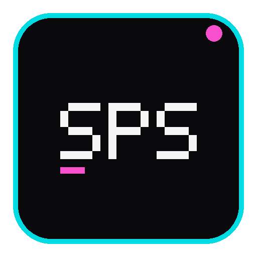

<p align="center"></p>

# system-prompt-switch

> Pick, stack, edit, and forget — system prompts that follow you from Pi to OMP without re-explaining yourself.

A Pi / OMP extension that manages custom system prompts per session: interactive modals, cumulative stacking, two scopes (local repo + global home), CRUD commands, and an above-editor banner that always shows what's active.


---

## Install

### OMP
```bash
omp install npm:system-prompt-switch
```

### PI
```bash
pi install npm:system-prompt-switch
```

That's it. The extension registers on next session start. Works in both Pi and OMP.

---

## Screenshots

Startup session modal — pick a prompt or create one:


Editor banner while creating a new prompt (Ctrl+Q submit, Esc cancel):


Demo GIFs:

**1. Select / Create system prompt when new session**


**2. Update system prompt (local or global)**


**3. Inject one or several system prompts for next message**


**4. Get information or logs**


**5. Delete a system prompt**


---

## What it does

- **Per-session prompts** — your active prompt is bound to the session ID, never leaks between concurrent or sequential sessions.
- **Two scopes, one mental model** — `[local]` lives in your repo (`.agents/system-prompts-switch/`, committable), `[global]` lives in your home (`~/.pi` or `~/.omp/agent/system-prompts-switch/`). Same file can exist in both; local wins for the repo session.
- **Stack multiple prompts** — `/sps-inject` adds prompts cumulatively. `[global] <system-prompt-name>.md + [local] project-rules.md` is a valid active state.
- **Above-editor banner** — the active prompt is rendered directly above your input prompt so you never forget which one is loaded.
- **Self-describing extension context** — every resolved prompt includes a leading block that tells the LLM what this extension is, where prompt files live, and how to inspect/change them. The block is loaded from `assets/templates/extension-context.md` so you can tweak the wording without touching code.
- **Per-project default** — your last choice in a project (startup modal, `/sps-select`, or a prompt just created with `/sps-new`, including `(None)`) becomes that project's default. New sessions there apply it silently, with no startup modal. Pick another with `/sps-select` to change it. If the default's file is gone, it is forgotten and the modal shows again. Dismissing the modal does not set a default.
- **Startup modal** — on terminal launch, pick `(None)`, an existing prompt, or create one. Enabled by default; set `promptOnStartup` to `false` to skip it while retaining `/sps-select` and other commands:
  - **OMP:** `~/.omp/agent/config.yml`
    ```yaml
    systemPromptSwitch:
      promptOnStartup: false
    ```
  - **Pi:** `~/.pi/agent/extensions/system-prompt-switch.json`
    ```json
    { "promptOnStartup": false }
    ```
- **Merge modes** — `append` (default, safe) keeps base instructions; `replace` uses your prompt as the base while preserving tools, skills, and project context.
- **Live logging** to `~/.pi/agent/logs/system-prompt-switch.log` / `~/.omp/agent/logs/system-prompt-switch.log`, with `/sps-logs [lines]` inside the session.

---

## Commands

| Command | What it does |
|---|---|
| `/sps-select [none\|<name>\|[local\|omp\|pi] <name>]` | Pick the active prompt (or `(None / Default)`); with an argument it selects directly, no picker |
| `/sps-inject` | Stack or toggle multiple prompts for this session |
| `/sps-new` | Create a new `.md` prompt (choose local vs global) |
| `/sps-edit` | Edit an existing prompt in the built-in editor |
| `/sps-path` | Print absolute paths for the active prompt and all local/global files |
| `/sps-delete` | Delete a prompt file (resets session if it was active) |
| `/sps-move` | Move a prompt file to another scope (local, global pi, or global omp) |
| `/sps-mode [append\|replace]` | Toggle or set the merge mode |
| `/sps-info` | Show host, active prompts, mode, session ID, and directories |
| `/sps-logs [lines]` | Tail the session log |

---

## How prompts live

| Scope | Default location | Override env |
|---|---|---|
| **Local (repo)** | `<cwd>/.agents/system-prompts-switch/` | `SPS_LOCAL_PROMPT_DIR` |
| **Global** | `~/.omp/agent/system-prompts-switch/` (OMP) or `~/.pi/agent/system-prompts-switch/` (Pi) | `SPS_PROMPT_DIR` or `SYSTEM_PROMPT_DIR` |
| **Session state** | `~/.<host>/agent/state/system-prompt-switch/sessions.json` | `SPS_STATE_PATH` |
| **Project default prompt** | `defaults.json` beside the session state file | follows `SPS_STATE_PATH` |

Legacy prompts in `~/.pi/agent/system-prompts/` are auto-migrated on first run.

### Reading the active prompt from another app

`sessions.json` is a public contract for clients (for example a chat UI driving omp over ACP): one entry per session ID, fields are only ever added.

```json
{
  "<sessionId>": {
    "activePrompts": [{ "name": "reviewer.md", "scope": "global-omp" }],
    "mode": "append",
    "enabled": true,
    "decided": true
  }
}
```

`scope` is `local`, `global-omp` or `global-pi`; `mode` is `append` or `replace`. To change it, send `/sps-select <name>` or `/sps-mode append|replace` as a prompt in that session.

Over ACP the startup modal does not block: the client may send the first message before the user picks, so that message runs without the prompt. A client that picks the prompt itself starts the host with `SPS_START_PICKER=0`: no startup modal, then it sends `/sps-select <name>` before the first message. Unset (the default, e.g. the terminal) keeps the modal.

---

## Editor shortcut note

When `/sps-new` or `/sps-edit` opens the built-in editor, an above-editor banner shows the **real** shortcuts: **Ctrl+Q** to submit, **Esc** to cancel. The host's footer also advertises `Ctrl+Enter submit` and `Ctrl+G external editor` — these are **not** wired by this extension; ignore them.

---

## For developers

Architecture, build, test, and contribution guide: see **[README.dev.md](./README.dev.md)**.

## License

[MIT](./LICENSE)
